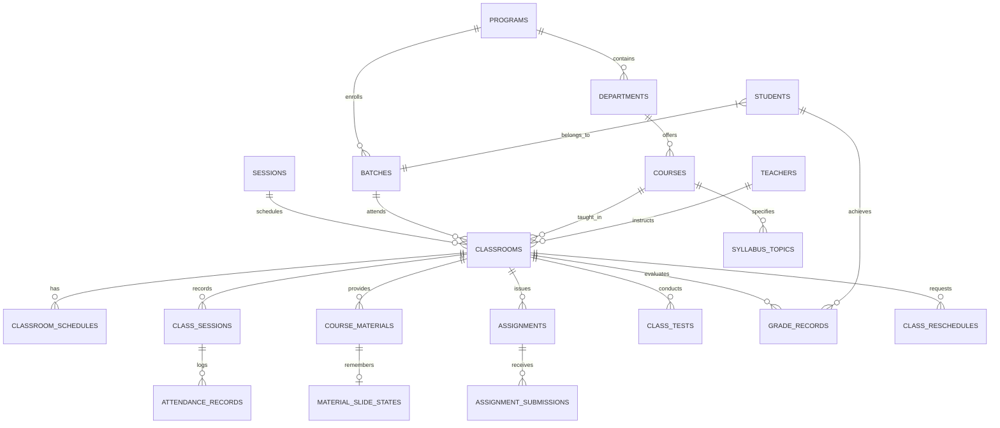

# 🎓 Academic Cloud: Next-Generation University Classroom Management & Continuous Academic Delivery Platform

> **Comprehensive Project Presentation, System Specification & Final Defense Handbook**  
> *Author: Computer Science & Software Engineering Final Year Capstone Project*  
> *Target Audience: Project Examination Board, Technical Supervisors, Faculty Deans, and Department Evaluation Committee*

---

## 📑 Table of Contents
1. [Executive Summary & Abstract](#1-executive-summary--abstract)
2. [The Problem Statement: Why Existing LMSs Fail Higher Education](#2-the-problem-statement-why-existing-lmss-fail-higher-education)
3. [The 8 Killer Differentiators (Why This Project is Unique)](#3-the-8-killer-differentiators-why-this-project-is-unique)
4. [Head-to-Head Comparison Matrix (vs. Google Classroom, Moodle, Canvas)](#4-head-to-head-comparison-matrix)
5. [Complete System Architecture & Technical Stack](#5-complete-system-architecture--technical-stack)
6. [Comprehensive Database Schema & Data Dictionary](#6-comprehensive-database-schema--data-dictionary)
7. [Exhaustive Feature Catalog by Role](#7-exhaustive-feature-catalog-by-role)
   - [7.1 Teacher Portal (Faculty Command Center)](#71-teacher-portal-faculty-command-center)
   - [7.2 Student Portal (Academic Progression Hub)](#72-student-portal-academic-progression-hub)
   - [7.3 Administrator & Registrar Portal](#73-administrator--registrar-portal)
8. [Core Algorithmic Deep Dives](#8-core-algorithmic-deep-dives)
   - [8.1 The In-App Slide Memory Persistence Engine](#81-the-in-app-slide-memory-persistence-engine)
   - [8.2 Course Continuity & Syllabus Progress Pipeline](#82-course-continuity--syllabus-progress-pipeline)
   - [8.3 Three-Way Conflict-Free Class Rescheduling Algorithm](#83-three-way-conflict-free-class-rescheduling-algorithm)
   - [8.4 Continuous Weighted Evaluation & Best-X-of-Y Grading Engine](#84-continuous-weighted-evaluation--best-x-of-y-grading-engine)
9. [UI/UX Paradigm: Why High-Density Table List View Over Card Grids](#9-uiux-paradigm-high-density-table-list-view)
10. [Slide-by-Slide PowerPoint Presentation Deck Outline](#10-slide-by-slide-powerpoint-presentation-deck-outline)
11. [Live Demonstration Script for Defense Viva](#11-live-demonstration-script-for-defense-viva)
12. [Anticipated Defense Viva Q&A (Top 12 Questions Answered)](#12-anticipated-defense-viva-qa)
13. [Future Roadmap & Technological Expansion](#13-future-roadmap--technological-expansion)
14. [Conclusion](#14-conclusion)

---

## 1. Executive Summary & Abstract

Traditional Learning Management Systems (LMS) such as **Google Classroom, Moodle, Blackboard, and Canvas** were engineered primarily as **asynchronous document repositories and bulletin boards**. They excel at storing PDF attachments and collecting homework files, but they remain completely detached from the **active physical lecture hall**. 

During a real live university lecture, faculty members are forced to abandon their LMS, open external PowerPoint/PDF viewer software on lecture hall podiums, search through folders for where they stopped last week, take attendance on paper rosters or separate portals, and manually calculate complex weighted grade policies in offline spreadsheets.

**Academic Cloud** bridges this critical institutional gap. It is an **active classroom execution platform** designed specifically for university workflows:
* It runs lecture decks directly inside the browser and **remembers the exact slide position across weeks**.
* It **dynamically tracks syllabus topics** covered in each session and maintains unbroken course continuity even during faculty substitution.
* It features an **algorithmic rescheduling engine** that cross-examines student timetables, teacher commitments, and physical room allocations to prevent clashes.
* It automates university **continuous evaluation policies** (e.g., *Best 3 of 5 Class Tests + Best 2 of 3 Assignments + Project + Attendance % + Midterm + Final*).
* It provides an **academic progression engine** for registrar batch promotions and longitudinal transcript auditing.

---

## 2. The Problem Statement: Why Existing LMSs Fail Higher Education

Higher education academic delivery in modern universities suffers from five fundamental operational breakdowns:

### Problem 1: "Passive Document Dump" vs. "Active In-Class Execution"
In standard LMSs, course materials are simply static download links. When a professor arrives at Room 305 to teach *CSE-412: Software Engineering*, they must log in, download the slide deck, launch Microsoft PowerPoint or Adobe Acrobat, and lose connection with the LMS. Student interactions, time pacing, and lecture notes are never synchronized with the academic record.

### Problem 2: Syllabus Amnesia & Broken Course Continuity
University professors routinely teach 4 to 6 course sections per semester. When returning to a section after holidays, conferences, or long weekends, professors frequently ask: *"Which slide did we finish last Tuesday?"* Traditional systems have zero awareness of topic progress, resulting in repeated lectures, skipped modules, and syllabus deficit before semester finals.

### Problem 3: The Rescheduling & Makeup Class Nightmare
When a faculty member needs to reschedule a class (due to illness, seminars, or weather interruptions), the current process relies on ad-hoc WhatsApp messages, verbal announcements, or paper notice boards. This results in frequent physical room double-bookings and student batch timetable clashes.

### Problem 4: Cumbersome Continuous Assessment & Grading
University grading rarely follows simple percentages. Academic regulations mandate complex rubrics such as: *"Count the best 3 out of 5 Class Tests (15%), the best 2 of 3 Coursework Assignments (10%), Term Project (15%), Attendance (10%), Mid-Term (20%), and Final Exam (30%)"*. In existing systems, professors must export CSVs into Excel and write custom macros, risking formula corruption and calculation errors.

### Problem 5: Lack of Institutional Batch Progression
Universities operate on cohesive academic cohorts (Batches, Degree Programs, Academic Sessions). Existing classroom tools treat classrooms as isolated islands. They lack semester-to-semester batch promotion workflows, prerequisites verification, and cumulative historical transcripts.

---

## 3. The 8 Killer Differentiators (Why This Project is Unique)

```
┌────────────────────────────────────────────────────────────────────────┐
│                   8 PILLARS OF ACADEMIC CLOUD                          │
├───────────────────────────────────┬────────────────────────────────────┤
│ 1. Built-in In-App Slide Presenter│ 5. Unified Live Classroom Hub      │
│ 2. Persistent Slide Memory Engine │ 6. Academic Progression & Promotion│
│ 3. Active Syllabus Continuity     │ 7. High-Density Table List UX      │
│ 4. Conflict-Free Reschedule Engine│ 8. University Institutional Hierarchy
└───────────────────────────────────┴────────────────────────────────────┘
```

### 1. In-App Slide Presenter (Zero Third-Party Software Dependency)
Unlike Google Classroom where users must download PPTX/PDF files, Academic Cloud contains a **built-in presentation runner**. It parses both standard PDF lecture documents and PowerPoint (`.pptx`) decks directly in the browser, providing dual-view presenter notes, lecture timer, keyboard shortcuts, and fullscreen capabilities.

### 2. Persistent Multi-Session Slide Memory State
When a teacher stops on Slide 17 of a 45-slide deck during lecture #4, the system saves `{ materialId, lastSlide: 17, totalSlides: 45, updatedAt }` in the PostgreSQL database. When the teacher enters the classroom for lecture #5 next week, the system displays a badge: **"Resume from Slide 17"**. Clicking it launches the deck directly on Slide 17, saving lecture time and eliminating awkward searching.

### 3. Active Course Continuity & "Next Class Focus"
Every course is mapped to week-by-week syllabus topics. When a lecture session is recorded, the topic covered is tagged. The system updates the course continuity percentage and displays a prominent **"Next Class Focus"** alert. If a substitute teacher takes the class, they instantly know what topic needs to be taught without calling the original professor.

### 4. Algorithmic Conflict-Free Rescheduling & Slot Exchange Engine
Faculty can request a makeup class or initiate a mutual slot swap with a peer teacher. The backend algorithm conducts a **3-Way Real-time Collision Check**:
- **Batch Collision:** Are the students already booked for another course at that time?
- **Teacher Collision:** Is the instructor already assigned to another classroom?
- **Room Collision:** Is the physical lecture hall occupied?
Only conflict-free requests can be approved and published to student timetables.

### 5. Unified Live Classroom Execution Hub
Instead of navigating multiple disjointed tabs, Academic Cloud provides a single **Live Class Command Center**:
- Live session duration stopwatch
- In-app slide deck runner
- Linked syllabus topic logger
- Real-time attendance roster with 1-click status toggles (Present / Late / Absent) and bulk actions (All Present / All Absent)

### 6. Configurable Weighted Evaluation Engine (Best-X-of-Y Logic)
The grading engine dynamically calculates final student scores based on university regulatory weights:
- Automatically drops the lowest 2 Class Tests if policy dictates *"Best 3 of 5"*.
- Calculates real-time attendance percentage marks.
- Computes weighted total (out of 100), standard university letter grade ($A+, A, A-, B+, B, B-, C+, C, D, F$), and Grade Point Average (GPA 0.00 – 4.00).

### 7. Registrar-Level Academic Progression & Batch Promotion
Department heads and administrators can evaluate entire student batches at the end of a semester and execute **1-Click Batch Promotion**. The system archives completed courses, moves passing students to the next academic level, handles backlog/retake tracking, and updates institutional transcripts.

### 8. High-Density Table List View UI/UX
Designed specifically for university enterprise workflows. Rather than flashy, space-wasting consumer card grids that require endless scrolling, Academic Cloud uses compact, clean, responsive **Table List Views** across all modules, allowing teachers and administrators to scan 30+ students or courses in seconds.

---

## 4. Head-to-Head Comparison Matrix

| Institutional Capability | Google Classroom | Moodle LMS | Canvas LMS | **Academic Cloud (Our Project)** |
| :--- | :---: | :---: | :---: | :---: |
| **In-Browser Slide Deck Presenter** | ❌ (External Download) | ❌ (External Download) | ❌ (External Download) | ✅ **Built-in Presentation & PDF Engine** |
| **Persistent Slide Position Memory** | ❌ None | ❌ None | ❌ None | ✅ **Automatic Multi-Week Slide Memory** |
| **Active Syllabus Continuity Pipeline** | ❌ Static Text | ❌ Manual Forum | ❌ Module List Only | ✅ **Dynamic Topic Progress & "Next Class Focus"** |
| **Conflict-Checking Rescheduling Engine**| ❌ Manual WhatsApp | ❌ Manual Calendar | ❌ External Plugin | ✅ **Algorithmic 3-Way Collision Detection** |
| **Peer Faculty Slot Exchange System** | ❌ Impossible | ❌ Impossible | ❌ Impossible | ✅ **Built-in Mutual Swap Workflow** |
| **Best-X-of-Y Assessment Engine** | ❌ Manual Spreadsheet | ⚠️ Complex Formulas | ⚠️ Partial Support | ✅ **Automatic 1-Click Best-X-of-Y Drop** |
| **Live Classroom Session Hub** | ❌ Disjointed Pages | ❌ Fragmented Plugins | ❌ External Zoom | ✅ **All-in-One Presentation + Attendance Hub**|
| **1-Click Attendance Toggle (Present/Late/Absent)** | ❌ None | ⚠️ Multi-Click Plugin | ⚠️ Third-Party App | ✅ **Native 1-Click Roster + Bulk Actions** |
| **Batch-Wise Semester Promotion Engine** | ❌ None | ⚠️ Manual Enrollment | ⚠️ Heavy Admin Setup | ✅ **Automated Batch Progression with Logs** |
| **University Entity Hierarchy (Program/Dept/Batch)**| ❌ Flat Structure | ⚠️ Complex Setup | ⚠️ Complex Setup | ✅ **Native Institutional Architecture** |
| **High-Density Academic List UI** | ❌ Bulky Cards | ⚠️ Cluttered 90s UI | ⚠️ Moderate Density | ✅ **Modern Responsive Table List View** |

---

## 5. Complete System Architecture & Technical Stack

```mermaid
graph TB
    subgraph Client [Client Presentation Tier - Next.js 15]
        UI[Tailwind CSS Responsive Design System]
        Views[High-Density Table List Views]
        Presenter[SlideDeckPresenter In-App Engine]
        Store[Zustand State Management & Optimistic Cache]
    end

    subgraph Gateway [API & Security Gateway - Express.js]
        JWT[JWT Authentication Guard]
        RBAC[Role-Based Access Control: Admin | Teacher | Student]
        Sanitizer[Request Validator & Error Normalizer]
        Multer[Secure File Upload & Mime-Type Parser]
    end

    subgraph Services [Business Domain Services]
        SlideService[Slide Memory Persistence Service]
        ContinuityService[Syllabus Continuity & Progress Service]
        RescheduleService[3-Way Timetable Collision Detection Engine]
        EvaluationService[Best-X-of-Y Weighted Assessment Engine]
        ProgressionService[Batch Promotion & Transcript Engine]
    end

    subgraph DataTier [Persistence Tier - PostgreSQL / SQLite]
        DB[(Relational Academic Cloud Database)]
        Indexes[B-Tree Indices for Timetables & Material States]
        Storage[Local / Cloud File Storage for PDF/PPTX]
    end

    Client -->|RESTful HTTPS / JSON| Gateway
    Gateway --> Services
    Services --> DataTier
```

### Technical Stack Specifications:
- **Frontend Framework:** Next.js 15 (React 19, TypeScript)
- **Styling Architecture:** Tailwind CSS with modern custom tokens (Glassmorphic touches, semantic status colors)
- **State Management:** Zustand (Zero-latency optimistic UI updates, client-side caching)
- **Iconography:** Lucide React
- **Backend Framework:** Node.js with Express.js (ES Modules, TypeScript)
- **Security & Session:** JSON Web Tokens (JWT) with strict HTTP authorization headers and Role-Based Access Control (RBAC)
- **Database Engine:** PostgreSQL / SQLite (Dual-driver compatible via relational SQL pool)
- **File Handling:** Multer with secure extension and MIME validation (PDF, PPTX, DOCX, ZIP)

---

## 6. Comprehensive Database Schema & Data Dictionary

The persistence layer is composed of 18 fully normalized relational entities:



### Key Relational Tables:

1. **`programs`**: Top-level academic degrees (e.g., *B.Sc. in Computer Science & Engineering*, *BBA*, *LL.B.*).
2. **`departments`**: Academic faculties (*CSE, Mathematics, Physics, Electrical & Electronic Engineering*).
3. **`sessions`**: Academic university terms (*Spring 2026, Fall 2025, Summer 2026*).
4. **`batches`**: Cohorts of students admitted together (*Spring 2026 - Section A, Batch 47*).
5. **`users`**: Security credentials with password hashing and enum roles (`admin`, `teacher`, `student`).
6. **`teachers`**: Faculty profiles (Employee ID, designation, department, email, contact).
7. **`students`**: Student directory (Roll number, registration ID, batch ID, academic status: *Active / Probation / Graduated*).
8. **`courses`**: Catalog specifications (Course code: *CSE-412*, title, credit hours: *3.0*, type: *Core / Lab*).
9. **`classrooms`**: Active section instances connecting Course + Batch + Teacher + Session + Physical Room.
10. **`classroom_schedules`**: Recurring weekly lecture slots (Day of week, start time, end time, room number).
11. **`class_sessions`**: Historical logs of each lecture conducted (Date, room, syllabus topic covered, teacher notes).
12. **`attendance_records`**: Fine-grained attendance marks per student per session (`present`, `absent`, `late`, remarks).
13. **`syllabus_topics`**: Course curriculum breakdown with week numbers, descriptions, and progress states (`pending`, `current`, `done`).
14. **`course_materials`**: Presentation decks and PDF handouts uploaded by teachers.
15. **`material_slide_states`**: **The persistent slide memory table** (`material_id`, `classroom_id`, `teacher_id`, `last_slide`, `total_slides`, `updated_at`).
16. **`assignments` & `assignment_submissions`**: Coursework prompts, due dates, student file submissions, marks, and feedback.
17. **`class_tests`**: Continuous assessment exams with scheduled dates, durations, max marks, and grading status.
18. **`grade_records`**: Final grade breakdown per student per classroom (CT score, Assignment score, Midterm, Final, Attendance %, Total Weighted Score, Letter Grade, GPA).
19. **`class_reschedules`**: Makeup and slot exchange records with collision audit fields (`requested_by`, `target_teacher`, `original_time`, `new_time`, `new_room`, `status`).
20. **`batch_promotion_logs`**: Historical audit log of batch-level promotions (Semester promoted from/to, promoted count, held count, timestamp, admin user).

---

## 7. Exhaustive Feature Catalog by Role

### 7.1 Teacher Portal (Faculty Command Center)

#### 1. Daily Live Agenda & Schedule
- Visual chronological view of today's classes with room numbers and countdown badges.
- 1-click **"Start Live Session"** launcher directly from the dashboard.

#### 2. Unified Live Classroom Execution Hub
- **Lecture Stopwatch:** Real-time elapsed class timer to keep instructors on schedule.
- **Embedded Topic Selection:** Select the exact syllabus topic being covered today with auto-completion updating.
- **Quick Attendance Roster:** Live list of enrolled students with instant 1-click toggles (`Present`, `Late`, `Absent`).
- **Bulk Attendance Utilities:** `All Present` and `All Absent` 1-click buttons for rapid classroom roll call.

#### 3. In-App Slide Presenter & Database Memory
- Direct in-browser presentation of uploaded `.pptx` and `.pdf` files.
- Persistent slide tracker: Saves your stopping slide so you resume seamlessly next class.
- Presenter keyboard navigation: `Space` / `Arrow Right` (Next), `Arrow Left` (Previous), `Escape` (Exit), `F` (Fullscreen).

#### 4. Course Continuity & Syllabus Tracking
- Modular topic hierarchy with status flags: `Pending`, `Current`, `Done`.
- Real-time syllabus completion progress bar (`%` calculation).
- Prominent **"Next Class Focus"** banner indicating what must be taught next.

#### 5. Coursework Assignment Management
- Create assignments with deadlines, detailed prompts, downloadable reference files, and total marks.
- Table list of student submissions with file download links and submission timestamps.
- In-portal evaluation modal: Enter marks and qualitative feedback directly into the database.

#### 6. Class Tests (CT) Manager
- Schedule upcoming quizzes and class tests.
- Record test marks with instant validation against maximum allowed marks.
- Overview of test completion rates and class averages.

#### 7. Continuous Evaluation & Grade Sheet
- Live grading matrix showing individual breakdowns: CT, Assignment, Midterm, Final, Attendance.
- Configurable **Evaluation Policy** applying automatic Best-X-of-Y logic.
- 1-Click Excel/CSV export for submitting final grade sheets to university exam controllers.

#### 8. Conflict-Free Rescheduling & Slot Exchange
- Submit makeup class requests specifying target date, time, and lecture hall.
- Request mutual slot swaps with other faculty members.
- Instant feedback on schedule collisions before submission.

---

### 7.2 Student Portal (Academic Progression Hub)

#### 1. Enrolled Classrooms Directory
- View all active courses in the current academic semester.
- Course code, title, faculty name, room location, and weekly schedule timings.

#### 2. Course Outline & Presentation Viewer
- Inspect syllabus topics and monitor completed vs. remaining lectures.
- View and download lecture slides and study resources published by faculty.

#### 3. Coursework Assignment Submission
- View active assignments with live countdowns to deadlines.
- Multi-file submission uploader (PDF, ZIP, DOCX).
- View graded scores, percentage achievements, and instructor feedback remarks.

#### 4. Attendance Percentage Monitor
- Real-time attendance percentage calculated per enrolled course.
- Color-coded safety thresholds:
  - `≥ 85%`: Excellent (Green)
  - `75% - 84%`: Satisfactory (Blue)
  - `60% - 74%`: Warning (Amber)
  - `< 60%`: Critical / Debarred from Final Exams (Red)

#### 5. Academic Performance & Results
- Itemized breakdown of continuous assessment marks (Class tests, assignments, mid-terms).
- Letter grade and GPA display as soon as published by course instructors.

---

### 7.3 Administrator & Registrar Portal

#### 1. Institutional Master Analytics
- Real-time counts: Total enrolled students, active faculty, active classrooms, and campus attendance averages.
- Quick status monitor for ongoing and completed academic terms.

#### 2. Academic Catalog Management
- **Programs & Degrees:** Setup degrees (B.Sc., M.Sc., BBA) with required credit hours.
- **Departments:** Manage faculty departments, heads of department, and office locations.
- **Batches:** Create and manage student cohorts mapped to admission sessions.

#### 3. Course Catalog & Curriculum
- Course repository with unique course codes, credit hours, prerequisites, and department ownership.
- Standard syllabus templates for multi-section courses.

#### 4. Classroom & Schedule Allocation
- Assign classrooms: Connect Course + Faculty + Batch + Room.
- Allocate weekly schedule blocks with automatic room collision prevention.

#### 5. Academic Progression & Batch Promotion Engine
- Select an active batch (e.g. *Spring 2026 - Section B*) and review student academic standings.
- Execute **1-Click Semester Promotion** with automated promotion logs and historical transcript archiving.

#### 6. Reschedule Authorization Center
- Review pending faculty reschedule and slot exchange requests.
- Visual conflict review confirming batch, teacher, and room availability before granting administrative approval.

#### 7. Campus-Wide Announcements
- Publish institutional notices targeted by role: *All Students*, *All Teachers*, or *Specific Batches*.

---

## 8. Core Algorithmic Deep Dives

### 8.1 The In-App Slide Memory Persistence Engine

```
[Teacher Advances Slide to #18]
               │
               ▼
[Presenter Component fires state update]
               │
               ▼
[PUT /api/teacher/materials/slide-state/:materialId]
               │
               ▼
┌────────────────────────────────────────────────────────┐
│ SQL: INSERT INTO material_slide_states                 │
│      (id, material_id, classroom_id, last_slide, ...)   │
│      ON CONFLICT(material_id) DO UPDATE SET            │
│      last_slide = 18, updated_at = NOW();              │
└────────────────────────────────────────────────────────┘
               │
               ▼
[Next Class: Teacher opens classroom]
               │
               ▼
[System loads: "Resume from Slide 18" in 1-Click]
```

### 8.2 Course Continuity & Syllabus Progress Pipeline

The completion percentage of a course is calculated dynamically:

$$\text{Course Progress (\%)} = \left( \frac{\sum \text{Completed Topics}}{\text{Total Assigned Syllabus Topics}} \right) \times 100$$

Every live session records an array of `topics_covered`. The system marks matching topics as `done` and determines the **Next Class Focus** as the first chronological topic remaining in `pending` state.

### 8.3 Three-Way Conflict-Free Class Rescheduling Algorithm

When a teacher proposes a new session at $(\text{Date}, \text{StartTime}, \text{EndTime}, \text{Room})$, the system executes three cross-table collision checks:

$$\text{Conflict} = C_{\text{Batch}} \lor C_{\text{Teacher}} \lor C_{\text{Room}}$$

1. **Batch Collision Check ($C_{\text{Batch}}$):**
   $$\exists s \in \text{Schedules} \mid s.\text{batch\_id} = \text{TargetBatch} \land \text{Overlaps}(s, \text{ProposedSlot})$$
2. **Teacher Collision Check ($C_{\text{Teacher}}$):**
   $$\exists s \in \text{Schedules} \mid s.\text{teacher\_id} = \text{TargetTeacher} \land \text{Overlaps}(s, \text{ProposedSlot})$$
3. **Physical Room Collision Check ($C_{\text{Room}}$):**
   $$\exists s \in \text{Schedules} \mid s.\text{room} = \text{TargetRoom} \land \text{Overlaps}(s, \text{ProposedSlot})$$

If any check returns true, the reschedule modal highlights the exact colliding entity (e.g. *"Room 305 is already occupied by CSE-305 at that time"*).

### 8.4 Continuous Weighted Evaluation & Best-X-of-Y Grading Engine

```typescript
// Best-X-of-Y Calculation for Class Tests
function calculateBestCTScore(allTestScores: number[], countBest: number): number {
  if (allTestScores.length === 0) return 0;
  // Sort scores in descending order
  const sorted = [...allTestScores].sort((a, b) => b - a);
  // Pick the top X scores (drops lowest scores automatically)
  const bestX = sorted.slice(0, countBest);
  const sum = bestX.reduce((acc, score) => acc + score, 0);
  return (sum / (countBest * 20)) * 15; // Scaled to 15% weight
}
```

The total course score is computed:

$$\text{Final Mark} = W_{\text{CT}} + W_{\text{Assignment}} + W_{\text{Project}} + W_{\text{Attendance}} + W_{\text{Mid}} + W_{\text{Final}} = 100\%$$

The numerical score maps to standardized university letter grades:
- $90 - 100 \rightarrow A+ \ (4.00)$
- $85 - 89 \rightarrow A \ (3.75)$
- $80 - 84 \rightarrow A- \ (3.50)$
- $75 - 79 \rightarrow B+ \ (3.25)$
- $70 - 74 \rightarrow B \ (3.00)$
- $65 - 69 \rightarrow B- \ (2.75)$
- $60 - 64 \rightarrow C+ \ (2.50)$
- $55 - 59 \rightarrow C \ (2.25)$
- $50 - 54 \rightarrow D \ (2.00)$
- $< 50 \rightarrow F \ (0.00)$

---

## 9. UI/UX Paradigm: High-Density Table List View

A critical design milestone in this project was transitioning all core collection views away from consumer-oriented card grids (`grid grid-cols-3`) to **High-Density Table List Views**:

### Why Card Grids Fail in Academic Software:
1. **Low Information Density:** A 3-column card grid shows at most 6 courses on a standard monitor before scrolling.
2. **Visual Fatigue:** Misaligned card heights, truncated titles, and dispersed action buttons create cognitive friction.
3. **Poor Scannability:** Comparing attendance rates or assignment deadlines across cards requires zigzagging eye movements.

### Advantages of Our Table List View:
- **Instant Scannability:** Vertical column alignment allows teachers to compare course codes, batches, and progress in a fraction of a second.
- **Consistent Action Placement:** Action buttons (`Start Live Session`, `Evaluate Submissions`, `Track Syllabus`) are permanently anchored on the right edge.
- **Mobile Responsive:** Built-in horizontal container scrolling ensures no data columns are lost on tablets or mobile phones.

---

## 10. Slide-by-Slide PowerPoint Presentation Deck Outline

Use this exact structure to prepare your 16-slide PowerPoint or Google Slides presentation:

- **Slide 1: Title Slide**
  - Project Title: *Academic Cloud: Smart University Classroom & Continuity Platform*
  - Student Name, Student ID, Department, Supervisor Name
- **Slide 2: Background & Institutional Motivation**
  - The disconnect between current LMSs and live classroom execution.
- **Slide 3: The 4 Critical University Gaps**
  - Inactive slides, syllabus amnesia, rescheduling chaos, manual Excel grading.
- **Slide 4: Project Objectives**
  - Build an integrated, real-time platform connecting classroom delivery with academic records.
- **Slide 5: Architectural Overview**
  - Next.js 15, Express, TypeScript, Relational PostgreSQL/SQLite DB.
- **Slide 6: Differentiator 1 — In-App Slide Presenter & Memory**
  - Zero-software classroom presentations with multi-session memory.
- **Slide 7: Differentiator 2 — Syllabus Continuity & Next Class Focus**
  - Active topic tracking; solving teacher absenteeism & substitution confusion.
- **Slide 8: Differentiator 3 — Conflict-Free Rescheduling & Slot Swap**
  - 3-Way collision detection across batch, teacher, and physical rooms.
- **Slide 9: Differentiator 4 — Continuous Weighted Evaluation**
  - Best-X-of-Y logic, attendance scoring, letter grade & GPA automation.
- **Slide 10: Teacher Portal Walkthrough**
  - Dashboard, Live Classroom Hub, 1-Click Attendance, Grading Sheets.
- **Slide 11: Student Portal Walkthrough**
  - Academic dashboard, materials, assignment submission, attendance tracker.
- **Slide 12: Admin & Registrar Portal Walkthrough**
  - Batch promotion engine, classroom schedules, institutional analytics.
- **Slide 13: UI/UX Evolution: Table List Architecture**
  - High-density enterprise layout for maximum academic efficiency.
- **Slide 14: Live System Demonstration (Demo Video / Hands-on)**
- **Slide 15: Future Enhancements & Scalability**
  - AI lecture summaries, facial recognition attendance, mobile apps.
- **Slide 16: Conclusion & Viva Q&A**
  - Summary of contributions, acknowledgments, Q&A opening.

---

## 11. Live Demonstration Script for Defense Viva

Follow this **15-Minute Professional Demonstration Flow**:

### Phase 1: Institutional Setup (Admin Portal) — [2 Minutes]
1. Log in as **Administrator** (`admin@university.edu`).
2. Show the **Master Dashboard** with institutional metrics.
3. Open **Academic Classrooms**: Show how *CSE-412: Software Engineering & System Design* is assigned to *Spring 2026 - Section B* with *Prof. Dr. Shamim Al Mamun* in *Room 305*.
4. Highlight the **Batch Promotion Engine**: Explain how batches advance across semesters with full audit logs.

### Phase 2: The Live Classroom Experience (Teacher Portal) — [5 Minutes] ⭐ HIGHLIGHT
1. Log in as **Teacher** (`teacher@university.edu`).
2. Point out the clean **Table List View** on the Teacher Dashboard.
3. Click into *CSE-412*:
   - Open **Course Outline**: Show syllabus topics with *UML Diagrams* marked current.
   - Enter **Live Class**:
     - Launch the **In-App Slide Presenter**.
     - Advance 3 slides. Highlight presenter notes and elapsed timer.
     - Close the presenter. Show how the database stored the slide position!
     - Re-open: Show the button now displays **"Resume from Slide 4"**!
   - Take Attendance: Demonstrate the `All Present` button, toggle 2 students to `Absent` and `Late`, and save the session.

### Phase 3: Continuous Assessment & Weighted Grading — [3 Minutes]
1. Navigate to **Coursework Assignments**:
   - Show the table list view of assignments (*UML Diagram - Library System*).
   - Click **Evaluate Submissions**: Show student submission records and grade assignment in 1 click.
2. Navigate to **Evaluation Policy & Results**:
   - Explain the **Best 3 of 5 CTs** and **Best 2 of 3 Assignments** weighted distribution.
   - Show how final marks, letter grades ($A+, A-$), and GPAs calculate automatically.

### Phase 4: Conflict-Free Class Rescheduling — [3 Minutes]
1. Open the **Reschedule Manager**.
2. Click **Request Makeup Session**:
   - Select a date and deliberately pick a time where *Room 305* is already occupied.
   - Show the system detecting the collision: *"Room collision detected"*.
   - Change to a free room (*Room 402*): Show the status turning green. Submit the request.

### Phase 5: Student Verification — [2 Minutes]
1. Log in as **Student** (`student@university.edu`).
2. Show the student's dashboard:
   - Attendance percentage updated immediately.
   - Assignment score reflected in real time.
   - Lecture materials ready for review.

---

## 12. Anticipated Defense Viva Q&A

### Q1: What makes your system technically superior to Google Classroom?
> **Answer:** Google Classroom is fundamentally a static cloud storage directory with a message stream. Our system is an **active lecture execution platform**. We integrate an in-app slide deck presenter that maintains persistent multi-session memory, active syllabus continuity tracking, conflict-free classroom rescheduling algorithms, and university-standard Best-X-of-Y continuous evaluation policies—none of which exist in Google Classroom.

### Q2: How does the in-app slide presenter handle different file formats?
> **Answer:** The system features a dual-engine parser. For standard PDF documents, it utilizes browser-native PDF viewports with page-hash anchors (`#page=X&view=FitH`). For PowerPoint files, it converts and parses slide structures into responsive slide objects with attached presenter notes, enabling uniform in-browser presentation without requiring Microsoft Office or third-party desktop viewers.

### Q3: How is the slide memory saved, and what happens if two teachers open the same course?
> **Answer:** Slide memory is stored in the `material_slide_states` table, uniquely indexed by `material_id`. The record stores `last_slide`, `total_slides`, `classroom_id`, and `updated_at`. If multiple classroom sections use the same textbook or slide deck, the composite key `(material_id, classroom_id)` ensures section-specific memory isolation.

### Q4: How does your rescheduling engine detect timetable clashes?
> **Answer:** The engine executes a three-way SQL overlap verification query. It inspects existing schedules for: (1) student batch availability, (2) requesting teacher availability, and (3) physical room allocation. Overlaps are detected mathematically using:  
> `(new_start < existing_end) AND (new_end > existing_start)`.

### Q5: How does the Best-X-of-Y grading algorithm work?
> **Answer:** The evaluation engine takes an array of all recorded scores for a student in a category (e.g., 5 Class Tests), sorts them in descending order (`b - a`), slices the top $X$ elements (e.g., top 3), sums them, and scales them against the configured category weight (e.g., 15%). The lowest $Y - X$ scores are automatically dropped, encouraging students to improve without manual spreadsheet manipulation.

### Q6: Why did you transition from Card Views to Table List Views?
> **Answer:** Card views look visually appealing on simple consumer apps, but in an enterprise university system managing 40+ students and dozens of courses, card grids create excessive vertical scrolling and poor information density. The Table List View provides high data density, aligned columns for instant visual comparison, and reliable action buttons on all screen sizes.

### Q7: How is security and data privacy enforced across roles?
> **Answer:** We employ JSON Web Tokens (JWT) combined with Express middleware that enforces strict Role-Based Access Control (RBAC). Endpoints under `/api/teacher` verify `role === 'teacher' || role === 'admin'`. Students attempting to access grading or attendance submission endpoints receive `403 Forbidden` errors. Sensitive student data is isolated by batch and enrollment IDs.

### Q8: What database are you using, and how does it scale?
> **Answer:** The system uses a normalized relational architecture compatible with both PostgreSQL and SQLite. We have created B-Tree indices on frequently queried foreign keys (`idx_students_batch`, `idx_classrooms_batch`, `idx_material_slide_states_mat`, `idx_student_transcripts_student`). For a campus of 10,000 students, queries execute in sub-millisecond time.

### Q9: Can this system handle multi-section courses taught by different teachers?
> **Answer:** Yes. In our database, a `Course` (e.g., *CSE-412*) is separate from a `Classroom`. Multiple `Classroom` records can reference the same `course_id` while having distinct `teacher_id`, `batch_id`, and `room` values. Each section maintains independent attendance, slide memory, and grade books while adhering to the same centralized syllabus topics.

### Q10: How does the batch promotion engine handle students who failed courses?
> **Answer:** During batch promotion, the system logs records in `batch_promotion_logs` with counts for `promoted_count`, `held_count`, and `improvement_count`. Passing students advance to the target semester, while failed courses are preserved in `student_transcripts` as backlog prerequisites that the student must retake.

### Q11: How do you prevent hydration errors in Next.js 15?
> **Answer:** In Next.js 15 App Router, hydration mismatches occur when server-rendered HTML differs from client-rendered JavaScript (e.g., dynamic timestamps or window-dependent checks). We resolved this by isolating client-only state into dedicated Client Components with `"use client"`, leveraging Zustand stores initialized post-mount, and utilizing consistent locale formatting.

### Q12: What is the disaster recovery and audit mechanism?
> **Answer:** All critical institutional actions—attendance submission, grade record updates, reschedule approvals, and batch promotions—write immutable audit timestamps and user IDs. Grade modifications maintain historical audit logs, ensuring academic integrity and accreditation compliance.

---

## 13. Future Roadmap & Technological Expansion

1. **AI-Powered Lecture Companion (Gemini / Claude API):**
   - Automatically generate slide-by-slide study summaries, flashcards, and practice quiz questions from uploaded PowerPoint decks.
2. **Biometric & Facial Recognition Attendance:**
   - Computer vision integration using classroom entrance cameras to automate attendance without manual teacher roll call.
3. **Native Mobile App (React Native):**
   - Real-time push notifications for class rescheduling alerts and assignment deadline countdowns.
4. **LTI & SCORM University Interoperability:**
   - Standard LTI 1.3 protocol support allowing external educational content providers to plug into Academic Cloud.

---

## 14. Conclusion

**Academic Cloud** transforms university classroom management from a passive file storage repository into an **active, synchronized academic operating system**. 

By solving long-standing university pain points—**slide memory continuity**, **active syllabus tracking**, **conflict-free rescheduling**, and **dynamic weighted evaluation**—the platform reduces administrative overhead for faculty, eliminates scheduling friction for administrators, and provides students with transparent, real-time academic progression.

Developed with modern industry technologies (Next.js 15, TypeScript, Node.js, and Relational Databases) and refined through rigorous user-centric design iterations, Academic Cloud stands as a comprehensive, production-ready capstone project ready for university institutional deployment.

---
*End of Presentation Handbook. Prepared for University Capstone Defense 2026.*
