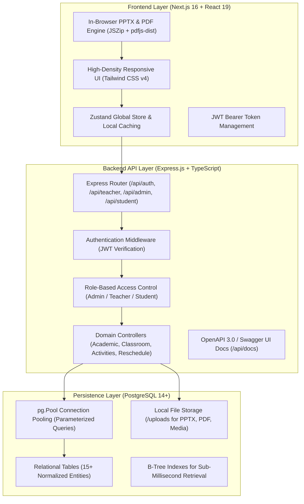
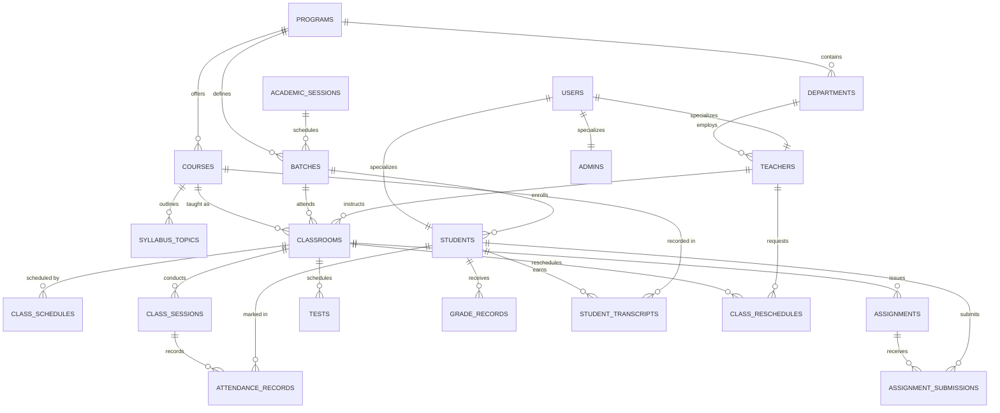

# 🎓 SCHOLARIS (ACADEMIC CLOUD)
## Next-Generation University Classroom Management & Continuous Academic Delivery Platform
### Comprehensive System Specification, Architectural Blueprint & Master Viva Defense Guide

---

> **Academic Project Details**
> - **Degree Program:** B.Sc. in Computer Science & Engineering / Post Graduate Diploma in Information Technology (PGDIT)
> - **Institution:** Jahangirnagar University, Savar, Dhaka, Bangladesh
> - **Developer & Candidate:** Tahmid Afsar Shapno (`shapno.official@gmail.com`)
> - **Project Scope:** Final Year Capstone Project / Thesis Defense
> - **Document Purpose:** Complete technical specification, architectural reference, and exhaustive Viva Voce (oral examination) handbook for answering internal and external university examination boards.

---

## 📑 Master Table of Contents
1. [Executive Summary & Abstract](#1-executive-summary--abstract)
2. [The Academic Problem Formulation](#2-the-academic-problem-formulation)
3. [The 8 Killer Differentiators (Why This Project is Unique)](#3-the-8-killer-differentiators-why-this-project-is-unique)
4. [Head-to-Head Comparison Matrix](#4-head-to-head-comparison-matrix)
5. [Complete System Architecture & Engineering Stack](#5-complete-system-architecture--engineering-stack)
6. [Relational Database Schema & Data Dictionary](#6-relational-database-schema--data-dictionary)
7. [The 5 Core Algorithmic Engines](#7-the-5-core-algorithmic-engines)
   - 7.1 [In-App Presentation Engine & Persistent Slide Memory](#71-in-app-presentation-engine--persistent-slide-memory)
   - 7.2 [Continuous Weighted Evaluation & Best-X-of-Y UGC Grading](#72-continuous-weighted-evaluation--best-x-of-y-ugc-grading)
   - 7.3 [Three-Way Conflict-Free Class Rescheduling Algorithm](#73-three-way-conflict-free-class-rescheduling-algorithm)
   - 7.4 [Active Course Continuity & Topic Progression Tracker](#74-active-course-continuity--topic-progression-tracker)
   - 7.5 [Institutional Cohort Batch Promotion & Academic Reintegration](#75-institutional-cohort-batch-promotion--academic-reintegration)
8. [Module-by-Module Technical Breakdown](#8-module-by-module-technical-breakdown)
   - 8.1 [Administrator & Registrar Portal](#81-administrator--registrar-portal)
   - 8.2 [Teacher & Faculty Command Center](#82-teacher--faculty-command-center)
   - 8.3 [Student Academic Progression Portal](#83-student-academic-progression-portal)
9. [Security, Authentication & Data Integrity](#9-security-authentication--data-integrity)
10. [Exhaustive Viva Voce Questions & Answers (40+ Master Q&As)](#10-exhaustive-viva-voce-questions--answers)
    - [Category A: Project Conception & High-Level Architecture (Q1-Q8)](#category-a-project-conception--high-level-architecture)
    - [Category B: Frontend Engineering & Next.js 16 App Router (Q9-Q16)](#category-b-frontend-engineering--nextjs-16-app-router)
    - [Category C: Backend Architecture, REST API & Node.js/Express (Q17-Q23)](#category-c-backend-architecture-rest-api--nodejsexpress)
    - [Category D: Relational Database, PostgreSQL, Normalization & Query Tuning (Q24-Q31)](#category-d-relational-database-postgresql-normalization--query-tuning)
    - [Category E: Algorithms, Business Rules & Mathematical Calculations (Q32-Q37)](#category-e-algorithms-business-rules--mathematical-calculations)
    - [Category F: Security, RBAC, Edge Cases & Deployment (Q38-Q43)](#category-f-security-rbac-edge-cases--deployment)
11. [Examiner "Trap" Questions & Defense Strategies](#11-examiner-trap-questions--defense-strategies)
12. [15-Minute Live Defense Demonstration Script](#12-15-minute-live-defense-demonstration-script)

---

## 1. Executive Summary & Abstract

Traditional Learning Management Systems (LMS) such as **Google Classroom, Moodle, Blackboard, and Canvas** were built as **asynchronous document storage lockers and announcement boards**. While they succeed at storing PDF attachments and collecting homework files, they are completely decoupled from the **active physical university classroom**.

In a real higher education environment:
- Faculty enter physical lecture halls, struggle with external presentation software (MS PowerPoint, Adobe Reader), and lose context of where they stopped in the previous lecture.
- Course syllabus completion is tracked manually, leading to "syllabus amnesia" and missed topics before semester finals.
- University grading does not use simple percentages; it requires intricate continuous evaluation policies (e.g., *Best 3 out of 5 Class Tests + Best 2 of 3 Assignments + Project + Attendance threshold + Midterm + Final*).
- Class makeup and rescheduling requests cause catastrophic timetable collisions across student batches, faculty commitments, and physical lecture halls.
- Classrooms exist as isolated units without institutional cohort hierarchy, preventing semester-to-semester batch promotions and transcript tracking.

**Scholaris (Academic Cloud)** resolves these critical institutional challenges by serving as an **active continuous classroom delivery operating system**. Engineered with **Next.js 16 (React 19)** on the frontend and an enterprise **Express.js + TypeScript + PostgreSQL** backend, Scholaris combines real-time lecture slide presentation memory, algorithmic conflict-free rescheduling, dynamic UGC-standard continuous grading, and cohort batch progression into a unified platform.

---

## 2. The Academic Problem Formulation

Modern university academic delivery suffers from five distinct operational failures:

### Problem 1: "Passive File Locker" vs. "Active In-Class Execution"
Traditional LMSs treat course materials as dead files on cloud storage. When an instructor arrives at Lecture Hall 305 to deliver a lecture on *CSE-412: Software Engineering*, they must download the file, launch a third-party viewer, and manually track student engagement. Scholaris brings the presentation engine inside the browser, complete with presenter notes, elapsed timers, interactive pens, and automatic slide position tracking.

### Problem 2: Syllabus Amnesia & Broken Course Continuity
Faculty members frequently teach 4 to 6 course sections per semester. Following holidays, conferences, or exam breaks, instructors lose continuity: *"Which slide did Section B finish last Thursday?"* Scholaris maintains persistent slide state per course material and maps every session to formal syllabus topics. If a substitute instructor steps in, they immediately know the exact topic and slide to begin from.

### Problem 3: The Rescheduling & Room Collision Crisis
Rescheduling makeup lectures traditionally relies on informal communication (WhatsApp groups, verbal notices, paper bulletin boards). This frequently results in physical room double-bookings and student batch clashes. Scholaris introduces a three-way automated mathematical collision engine to verify student availability, instructor commitments, and physical room capacity.

### Problem 4: Complex Continuous Evaluation Rubrics
University grading policies mandate non-linear grading rules (e.g., dropping the lowest 2 of 5 quiz scores). Instructors currently export scores to Excel spreadsheets, risking formula breakage and audit discrepancies. Scholaris provides an automated *Best-X-of-Y* evaluation engine that computes grades in real time according to configurable institutional policies.

### Problem 5: Absence of Institutional Cohort Hierarchy
Most LMS tools treat every course as a disconnected silo. Universities operate on hierarchical cohorts: `Department` $\rightarrow$ `Degree Program` $\rightarrow$ `Academic Session` $\rightarrow$ `Batch / Cohort` $\rightarrow$ `Student`. Scholaris enforces this hierarchy natively, enabling multi-semester batch promotions, academic hold handling, and cumulative GPA transcript generation.

---

## 3. The 8 Killer Differentiators (Why This Project is Unique)

```
┌────────────────────────────────────────────────────────────────────────┐
│                   8 PILLARS OF SCHOLARIS (ACADEMIC CLOUD)              │
├───────────────────────────────────┬────────────────────────────────────┤
│ 1. In-App Universal Slide Runner  │ 5. Three-Way Rescheduling Engine   │
│ 2. Persistent Multi-Session Memory│ 6. Continuous UGC Weighted Grading │
│ 3. Active Syllabus Continuity Hub │ 7. Institutional Cohort Hierarchy  │
│ 4. Instant Live Class Operations  │ 8. High-Density Table List View UX │
└───────────────────────────────────┴────────────────────────────────────┘
```

1. **In-App Universal Slide Runner:** Parses `.pptx` (PowerPoint) and `.pdf` files client-side directly in the browser using custom XML extraction via `JSZip` and canvas rendering via `pdfjs-dist`. Zero third-party desktop apps needed.
2. **Persistent Multi-Session Slide Memory:** When an instructor stops at Slide 14 of 42, the state is persisted to PostgreSQL (`material_slide_states`). When returning next week, the system prompts: *"Resume from Slide 14"*.
3. **Active Syllabus Continuity Hub:** Maps course outlines week-by-week. Each session logged tags the syllabus topic covered, automatically calculating percentage completion.
4. **Instant Live Class Operations:** A single command dashboard for running slides, conducting roll-call attendance with one-tap status toggling (`present`, `absent`, `late`), and writing session logs.
5. **Three-Way Conflict-Free Rescheduling:** Mathematical interval validation across student cohorts, faculty schedules, and physical rooms before any schedule modification is committed.
6. **Continuous UGC Weighted Grading:** Dynamic Best-X-of-Y calculation for Class Tests and Assignments with customizable weight sliders totaling 100%.
7. **Institutional Cohort Hierarchy & Batch Promotion:** Multi-level relational modeling supporting university registrar workflows: batch promotions, academic holds, semester gaps, and student transcript auditing.
8. **High-Density Table List View UX:** Replaces inefficient consumer-oriented card grids with structured, high-density tabular interfaces optimized for handling 50+ students per screen.

---

## 4. Head-to-Head Comparison Matrix

| Institutional Feature | Google Classroom | Moodle LMS | Canvas LMS | **Scholaris (This Project)** |
| :--- | :---: | :---: | :---: | :---: |
| **In-Browser PPTX Slide Presenter** | ❌ (Static preview) | ❌ (Download only) | ❌ (Download only) | ✅ **Full In-App Runner with Presenter Notes** |
| **Persistent Slide Position Memory** | ❌ | ❌ | ❌ | ✅ **PostgreSQL Indexed Memory State** |
| **Syllabus Topic Continuity Tracking** | ❌ | ⚠️ (Manual plugin) | ⚠️ (Modules only) | ✅ **Built-in Session-to-Syllabus Mapping** |
| **Substitute Teacher Handoff Context** | ❌ | ❌ | ❌ | ✅ **Instant "Next Class Focus" Alert** |
| **3-Way Real-Time Clash Detection** | ❌ | ❌ | ❌ | ✅ **Mathematical Interval Collision Check** |
| **Best-X-of-Y Weighted Grade Engine** | ❌ | ⚠️ (Complex formula) | ⚠️ (Basic drop rule) | ✅ **Interactive UGC Sliders & Auto Calculation** |
| **Cohort Batch Promotion Engine** | ❌ | ❌ | ❌ | ✅ **Registrar Batch Advancement & Hold Logs** |
| **Information Density Paradigm** | Card Grid (High scroll) | Cluttered Portal | Multi-layer Menus | ✅ **High-Density Data Table List View** |
| **Interactive Slide Annotation & Timer**| ❌ | ❌ | ❌ | ✅ **Built-in Laser, Pen, Highlighter & Timer** |
| **Self-Hosted Relational Ownership** | ❌ (Proprietary Google) | ✅ (PHP/MySQL) | ⚠️ (Canvas Open Source) | ✅ **Modern TypeScript + Node.js + PostgreSQL** |

---

## 5. Complete System Architecture & Engineering Stack



### Detailed Technology Stack Specifications

#### 1. Frontend Technologies
- **Next.js 16.3.0 (App Router):** Server & Client Component separation, Turbopack bundling, file-system routing.
- **React 19.2.8:** Modern declarative UI library with React Server Components (RSC) and hook architecture.
- **Tailwind CSS v4:** Zero-runtime utility CSS engine with custom design tokens for academic status badges and tables.
- **JSZip 3.10.2:** Client-side decompression of Office Open XML (`.pptx`) archives for extracting slide XML documents and embedded media.
- **pdfjs-dist 6.4.299:** Web standards-compliant canvas renderer for vector PDF lecture documents.
- **Lucide React 1.31.0:** Consistent iconography across admin, faculty, and student portals.
- **Recharts 3.10.1:** Interactive analytical data visualizations for attendance trends and grade distributions.
- **Framer Motion 13.1.0:** Hardware-accelerated UI transitions and modal animations.

#### 2. Backend Technologies
- **Node.js (v20+ LTS):** Asynchronous event-driven runtime environment.
- **Express.js 4.21.2:** High-performance web framework structuring RESTful micro-endpoints.
- **TypeScript 5.7.2:** End-to-end static type enforcement preventing runtime data bugs.
- **JSON Web Tokens (jsonwebtoken 9.0.3):** Cryptographically signed stateless access tokens with customizable expiry.
- **Bcrypt.js 3.0.3:** Adaptive password hashing with configurable cryptographic work factors (salt rounds = 10).
- **Multer 2.4.0:** Multipart form-data parser with disk storage handlers and MIME-type validators.
- **Swagger UI Express 5.0.1:** Interactive API testing interface compliant with OpenAPI 3.0.

#### 3. Database & Infrastructure
- **PostgreSQL 14+:** ACID-compliant object-relational database.
- **pg (node-postgres 8.13.1):** High-throughput connection pool manager executing strictly parameterized SQL statements.

---

## 6. Relational Database Schema & Data Dictionary



### Data Dictionary: Key Relational Tables

| Table Name | Primary Key | Foreign Keys & Relationships | Purpose |
| :--- | :--- | :--- | :--- |
| `programs` | `id` | `department_id` $\rightarrow$ `departments(id)` | Academic degree programs (e.g., B.Sc. in CSE, PGDIT) |
| `departments` | `id` | `program_id` $\rightarrow$ `programs(id)` | Academic departments (e.g., Dept of CSE) |
| `academic_sessions` | `id` | None | Session intervals (e.g., Spring 2026, Fall 2025) |
| `batches` | `id` | `program_id`, `session_id` | Student cohorts/sections (e.g., SP26-A, SP26-B) |
| `users` | `id` | None | Base identity table storing `email`, `password_hash`, `role` |
| `teachers` | `id` | `id` $\rightarrow$ `users(id)`, `department_id` | Faculty profiles with designation and academic department |
| `students` | `id` | `id` $\rightarrow$ `users(id)`, `batch_id` | Student profiles with roll number, batch link, status |
| `courses` | `id` | `program_id` $\rightarrow$ `programs(id)` | Course catalog with code, title, and credit weighting |
| `syllabus_topics` | `id` | `course_id` $\rightarrow$ `courses(id)` | Week-by-week syllabus topics with status (`pending`, `current`, `done`) |
| `classrooms` | `id` | `course_id`, `batch_id`, `teacher_id` | Active course offerings linking teacher, batch, and room |
| `class_schedules` | `id` | `classroom_id` $\rightarrow$ `classrooms(id)` | Weekly timetable slots (`day`, `start_time`, `end_time`, `room`) |
| `class_sessions` | `id` | `classroom_id` $\rightarrow$ `classrooms(id)` | Historical conducted lecture records with topics and notes |
| `attendance_records` | `id` | `session_id`, `classroom_id`, `student_id` | Roll-call attendance (`present`, `absent`, `late`) |
| `assignments` | `id` | `classroom_id` $\rightarrow$ `classrooms(id)` | Homework tasks with due dates, total marks, instructions |
| `assignment_submissions` | `id` | `assignment_id`, `student_id` | Student submissions (text, files, GitHub links, grades) |
| `tests` | `id` | `classroom_id` $\rightarrow$ `classrooms(id)` | Class Tests (CTs), Quizzes, Midterms, Final exam entries |
| `grade_records` | `id` | `classroom_id`, `student_id`, `assignment_id`/`test_id` | Raw mark entries with remarks |
| `student_transcripts` | `id` | `student_id`, `course_id` | Final computed semester scores, letter grades, GPAs |
| `material_slide_states` | `id` | `material_id` (Unique) | Persistent slide memory (`last_slide`, `total_slides`) |
| `class_reschedules` | `id` | `classroom_id`, `requested_by_teacher_id`, `target_teacher_id` | Makeup class requests and teacher slot exchanges |
| `batch_promotion_logs` | `id` | `batch_id` $\rightarrow$ `batches(id)` | Registrar audit logs for semester batch advancements |

### Strategic Database Indexing
To ensure high-throughput execution even under load with thousands of student queries:
- `idx_students_batch` ON `students(batch_id)` $\rightarrow$ Accelerates batch roster retrieval.
- `idx_classrooms_batch` ON `classrooms(batch_id)` $\rightarrow$ Speeds up student classroom discovery.
- `idx_attendance_records_student` ON `attendance_records(student_id)` $\rightarrow$ Optimizes student attendance aggregation.
- `idx_material_slide_states_mat` ON `material_slide_states(material_id)` $\rightarrow$ Delivers instant slide state lookup.
- `idx_student_transcripts_student` ON `student_transcripts(student_id)` $\rightarrow$ Powers immediate transcript rendering.

---

## 7. The 5 Core Algorithmic Engines

### 7.1 In-App Presentation Engine & Persistent Slide Memory

```
┌──────────────────────────────────────────────────────────────────────────────────┐
│                         SLIDE MEMORY PERSISTENCE PIPELINE                        │
├──────────────────────────────────────────────────────────────────────────────────┤
│ 1. Instructor opens slide deck in Lecture Hall                                   │
│ 2. Frontend calls GET /api/teacher/materials/slide-state/:materialId             │
│    ──> Database returns { lastSlide: 17, totalSlides: 45 }                       │
│ 3. In-App Runner prompts: "Resume from Slide 17"                                 │
│ 4. Instructor advances to Slide 24 during 90-minute lecture                      │
│ 5. Slide change triggers debounced PUT /api/teacher/materials/slide-state        │
│ 6. PostgreSQL executes UPSERT:                                                   │
│    INSERT INTO material_slide_states (...) VALUES (...)                          │
│    ON CONFLICT (material_id) DO UPDATE SET last_slide = 24;                      │
└──────────────────────────────────────────────────────────────────────────────────┘
```

#### Client-Side PPTX Parser Algorithm (`pptxParser.ts`)
1. Accepts a `File`, `Blob`, or server URL.
2. Reads binary data into an `ArrayBuffer` and unpacks the OpenXML ZIP container using `JSZip`.
3. Discovers all slide files matching the regex `/^ppt\/slides\/slide[0-9]+\.xml$/`.
4. Sorts slides numerically: `slide1.xml`, `slide2.xml`, ..., `slideN.xml`.
5. Iterates through slide XML nodes:
   - Extracts slide titles from `<p:sp>` text shapes (`<a:t>`).
   - Extracts bullet lists and body paragraphs.
   - Parses `_rels/slideX.xml.rels` to map embedded image IDs to binary assets in `ppt/media/`.
   - Converts binary images to base64 Data URLs for direct canvas/DOM rendering.

#### Server-Side Slide State Upsert (`activities.controller.ts`)
```sql
INSERT INTO material_slide_states (
  id, material_id, classroom_id, teacher_id, last_slide, total_slides, material_title, updated_at
) VALUES ($1, $2, $3, $4, $5, $6, $7, CURRENT_TIMESTAMP)
ON CONFLICT (material_id) DO UPDATE SET
  last_slide = EXCLUDED.last_slide,
  total_slides = EXCLUDED.total_slides,
  classroom_id = COALESCE(EXCLUDED.classroom_id, material_slide_states.classroom_id),
  teacher_id = COALESCE(EXCLUDED.teacher_id, material_slide_states.teacher_id),
  updated_at = CURRENT_TIMESTAMP
RETURNING *;
```

---

### 7.2 Continuous Weighted Evaluation & Best-X-of-Y UGC Grading

Universities enforce non-linear continuous evaluation policies. A typical UGC curriculum allocates:
$$\text{Total Score} = W_{\text{CT}} + W_{\text{Assn}} + W_{\text{Proj}} + W_{\text{Att}} + W_{\text{Mid}} + W_{\text{Final}} = 100\%$$

Where:
- $W_{\text{CT}} = 15\%$ (Best 3 out of 5 Class Tests)
- $W_{\text{Assn}} = 10\%$ (Best 2 out of 3 Coursework Assignments)
- $W_{\text{Proj}} = 15\%$ (Term Project)
- $W_{\text{Att}} = 10\%$ (Attendance score with minimum 75% threshold)
- $W_{\text{Mid}} = 20\%$ (Mid-Term Examination)
- $W_{\text{Final}} = 30\%$ (Semester Final Examination)

#### Best-X-of-Y Algorithmic Formula
Given $N$ recorded marks for a student in a category: $S = [s_1, s_2, s_3, \dots, s_N]$ with each mark normalized to a common scale out of $M_{\max}$:
1. Sort scores in descending order: $S_{\text{sorted}} = \text{sort\_desc}(S)$
2. Select the top $X$ scores: $S_{\text{top}} = S_{\text{sorted}}[0 : X]$
3. Sum the top $X$ scores: $\Sigma_{\text{top}} = \sum_{i=0}^{X-1} S_{\text{top}}[i]$
4. Calculate category contribution:
$$\text{Mark}_{\text{category}} = \left( \frac{\Sigma_{\text{top}}}{X \times M_{\max}} \right) \times W_{\text{category}}$$

#### Standard University Letter Grade & GPA Conversion
$$\text{Total Percentage } P = \frac{\text{Total Obtained Marks}}{100} \times 100$$

$$\text{Grade}(P) = \begin{cases} 
\text{A+} & P \ge 80\% \quad (\text{GPA: } 4.00) \\
\text{A}  & 75\% \le P < 80\% \quad (\text{GPA: } 3.75) \\
\text{A-} & 70\% \le P < 75\% \quad (\text{GPA: } 3.50) \\
\text{B+} & 65\% \le P < 70\% \quad (\text{GPA: } 3.25) \\
\text{B}  & 60\% \le P < 65\% \quad (\text{GPA: } 3.00) \\
\text{B-} & 55\% \le P < 60\% \quad (\text{GPA: } 2.75) \\
\text{C+} & 50\% \le P < 55\% \quad (\text{GPA: } 2.50) \\
\text{C}  & 45\% \le P < 50\% \quad (\text{GPA: } 2.25) \\
\text{D}  & 40\% \le P < 45\% \quad (\text{GPA: } 2.00) \\
\text{F}  & P < 40\% \quad (\text{GPA: } 0.00)
\end{cases}$$

---

### 7.3 Three-Way Conflict-Free Class Rescheduling Algorithm

When an instructor requests a makeup class or slot swap, the backend executes an atomic collision check against existing schedules.

```
                  ┌─────────────────────────────────────┐
                  │    RESCHEDULING CONFLICT CHECK      │
                  └──────────────────┬──────────────────┘
                                     │
           ┌─────────────────────────┼─────────────────────────┐
           ▼                         ▼                         ▼
   [ Batch Collision ]      [ Teacher Collision ]       [ Room Collision ]
 Are students occupied?    Is teacher scheduled?      Is room double-booked?
```

#### Mathematical Overlap Condition
Two time intervals $[S_{\text{req}}, E_{\text{req}}]$ and $[S_{\text{exist}}, E_{\text{exist}}]$ on the same calendar day collide if and only if:
$$\text{Collision} = (S_{\text{req}} < E_{\text{exist}}) \land (E_{\text{req}} > S_{\text{exist}})$$

#### SQL Collision Query
```sql
SELECT sch.id, sch.room, c.batch_id, c.teacher_id
FROM class_schedules sch
JOIN classrooms c ON sch.classroom_id = c.id
WHERE sch.day = $1
  AND (sch.start_time < $3 AND sch.end_time > $2)
  AND (
    c.batch_id = $4       -- 1. Batch conflict
    OR c.teacher_id = $5   -- 2. Teacher conflict
    OR sch.room = $6      -- 3. Room conflict
  );
```
If this query returns any records, the request is flagged with the exact collision reason; otherwise, it is authorized.

---

### 7.4 Active Course Continuity & Topic Progression Tracker

To solve "syllabus amnesia," every course outline is broken down into ordered topics with associated weeks:
- Status values: `pending`, `current`, `done`
- Whenever a class session is recorded in `class_sessions`, the topic taught is linked to `syllabus_topics`.
- The system automatically marks that topic as `done` and advances the subsequent topic to `current`.
- Course Progress Metric:
$$\text{Course Progress } (\%) = \left( \frac{\text{Count of Completed Topics}}{\text{Total Syllabus Topics}} \right) \times 100$$
- If a substitute instructor logs in, the dashboard prominently surfaces the **"Next Class Focus"**, ensuring seamless pedagogical continuity.

---

### 7.5 Institutional Cohort Batch Promotion & Academic Reintegration

In university administrations, students advance as cohesive cohorts (e.g., from *Semester 3* to *Semester 4*). 

#### Promotion Workflow
1. The administrator selects a source batch (e.g., `SP26-A`).
2. The system reviews every enrolled student's continuous grades and attendance.
3. For each student, the administrator or system assigns a status:
   - `promote`: Advances student to target semester batch.
   - `hold`: Retains student in current semester due to fee arrears or disciplinary hold.
   - `gap`: Registers a formal semester gap/leave of absence.
   - `drop`: Formally drops the student from the academic program.
   - `improvement`: Allows student to sit for improvement examinations on failed courses.
4. An immutable audit record is committed to `batch_promotion_logs` containing `total_students`, `promoted_count`, `held_count`, `improvement_count`, and the `executed_by` admin identity.

---

## 8. Module-by-Module Technical Breakdown

### 8.1 Administrator & Registrar Portal
- **Dashboard & Analytics:** Institutional KPI cards (Total Students, Active Faculty, Classrooms Running, Attendance Averages, Pending Reschedules).
- **Academic Structure CRUD:** Full management of Departments, Degree Programs, Academic Sessions, Batches/Sections, Courses, and Syllabus Outlines.
- **User Provisioning:** Create, view, edit, and deactivate Teachers, Students, and Administrators with role-based attributes (roll numbers, designations).
- **Classroom Allocation:** Assign Courses to Batches and Teachers, allocate physical rooms, configure schedules.
- **Batch Promotion Manager:** Execute cohort semester advancement with automated audit logs.
- **Institution Settings:** Configure university name, academic grading scales, and institutional logos.

### 8.2 Teacher & Faculty Command Center
- **High-Density Classroom Hub:** Table view of all assigned courses with section badges, schedule times, and completion percentages.
- **Live Class Presenter:**
  - In-browser PPTX & PDF runner with zero desktop software requirements.
  - Laser pointer, pen tool, highlighter, eraser, and drawing canvas.
  - Presenter notes drawer, lecture timer, fullscreen toggle.
  - Persistent slide memory sync with PostgreSQL.
- **Instant Attendance Logging:** One-click roll-call with `All Present` button and quick toggles for `Absent` and `Late`.
- **Coursework & Assessment Management:**
  - Create and distribute assignments with attachment URLs and due dates.
  - Evaluate student submissions, provide qualitative feedback, and assign marks.
  - Schedule Class Tests (CTs) and quizzes.
- **Continuous Evaluation Engine:** Configure Best-X-of-Y UGC policies with real-time grade calculations and CSV export.
- **Class Reschedule & Slot Swap:** Submit makeup class requests with automated clash detection.

### 8.3 Student Academic Progression Portal
- **Consolidated Academic Dashboard:** View today's class schedule, active assignments, upcoming tests, and announcements.
- **Classroom Explorer:** Access enrolled courses, faculty contact details, and syllabus outlines.
- **Material Study Hub:** Review uploaded lecture notes and slide decks with personal slide progress indicators.
- **Assignment Submission Pipeline:** Submit homework assignments via rich text, file links, and GitHub repository URLs.
- **Real-Time Attendance Audit:** Track subject-wise attendance percentages with warnings if attendance falls below the mandatory 75% threshold.
- **Grade Book & Transcripts:** Transparent breakdown of Class Tests, Assignments, Midterms, Final exam marks, Letter Grades, and Grade Points.

---

## 9. Security, Authentication & Data Integrity

```
┌────────────────────────────────────────────────────────────────────────┐
│                      AUTHENTICATION & RBAC FLOW                        │
├────────────────────────────────────────────────────────────────────────┤
│ 1. Client POSTs credentials to /api/auth/login                         │
│ 2. Backend queries users table, verifies password with bcrypt.compare  │
│ 3. On success, signs JWT containing: { id, email, role, name }         │
│ 4. Client stores JWT in localStorage and attaches to requests:         │
│    Authorization: Bearer <token>                                       │
│ 5. Express Middleware:                                                 │
│    - authenticateToken: Verifies signature and expiration             │
│    - authorizeRoles('admin', 'teacher'): Enforces RBAC permissions     │
└────────────────────────────────────────────────────────────────────────┘
```

### Key Security Safeguards
1. **Cryptographic Password Hashing:** Passwords are never stored in plaintext. They are salted and hashed using `bcryptjs` with 10 rounds.
2. **Stateless JWT Authorization:** API requests authenticate via HTTP `Bearer` tokens in the `Authorization` header, preventing session hijacking.
3. **Strict RBAC Enforcement:** Role guards prevent unauthorized vertical privilege escalation (e.g., students attempting to access teacher grading endpoints receive `403 Forbidden`).
4. **SQL Injection Immunity:** All database queries utilize parameterized arguments (`$1, $2, ...`) via `node-postgres`, guaranteeing that user inputs cannot alter SQL query trees.
5. **CORS Origin Whitelisting:** The backend restricts API requests to authorized frontend origins.
6. **ACID Transaction Safeguards:** Multi-table operations (such as saving attendance batches or processing batch promotions) run within `BEGIN ... COMMIT / ROLLBACK` database transactions.

---

## 10. Exhaustive Viva Voce Questions & Answers

### Category A: Project Conception & High-Level Architecture

#### Q1: What is the core motivation behind developing Scholaris (Academic Cloud)?
> **Answer:**  
> Traditional LMS platforms like Google Classroom and Moodle are passive asynchronous document repositories. They do not cater to the live physical classroom environment. During a lecture, faculty must leave the LMS, open external desktop presentation software, manually recall where they stopped last week, take attendance on paper rosters, and later compute complex non-linear grades in Excel. Scholaris was designed as an active continuous academic delivery platform that combines in-browser slide presentations with slide memory, active syllabus continuity tracking, conflict-free class rescheduling, and automated Best-X-of-Y UGC grading.

#### Q2: Why did you choose a decoupled Client-Server architecture over a monolithic server-rendered framework?
> **Answer:**  
> We separated the system into a **Next.js 16 (React 19)** frontend and an **Express.js (TypeScript) + PostgreSQL** backend. This decoupling provides three major benefits:
> 1. **Independent Scalability:** The stateless API backend can be scaled horizontally behind a load balancer without redeploying the frontend.
> 2. **Multi-Client Readiness:** The RESTful API layer is already prepared to support future native mobile apps (React Native) or IoT classroom terminals.
> 3. **Separation of Concerns:** The frontend handles heavy in-browser tasks (PPTX XML parsing, canvas PDF rendering, client-side caching), while the backend focuses strictly on business logic, security enforcement, and relational transactions.

#### Q3: How does Scholaris differ from Google Classroom for university faculty?
> **Answer:**  
> Google Classroom lacks key institutional workflows:
> - It cannot present PowerPoint slides natively with presenter notes inside the browser.
> - It has no slide position persistence across weeks.
> - It does not track syllabus topics against semester weeks.
> - It cannot detect room or timetable clashes when a lecture is rescheduled.
> - It cannot compute continuous evaluation rubrics like "Best 3 of 5 Class Tests".
> Scholaris provides all these features natively within a single, unified interface.

#### Q4: Why did you choose Express.js with TypeScript over plain JavaScript?
> **Answer:**  
> In enterprise academic systems where multiple relational entities interact (Batches, Classrooms, Transcripts), plain JavaScript easily leads to runtime `undefined is not a function` or type mismatch errors. TypeScript provides compile-time type safety, structured interfaces (`AuthUser`, `ClassSchedule`, `GradeRecord`), auto-completion in IDEs, and self-documenting code, substantially reducing production defects.

#### Q5: Can you explain the Layered MVC design pattern in your backend?
> **Answer:**  
> Our backend follows a structured layered architecture:
> - **Routes Layer (`backend/src/routes`):** Defines HTTP endpoints, parses path parameters, and binds authentication and role-checking middleware.
> - **Middleware Layer (`backend/src/middleware`):** Verifies JWT tokens (`authenticateToken`) and validates role permissions (`authorizeRoles`).
> - **Controllers Layer (`backend/src/controllers`):** Contains business logic, input validation, mathematical grade scaling, and collision algorithms.
> - **Data Access Layer (`backend/src/config/db.ts`):** Manages the PostgreSQL connection pool and executes parameterized SQL queries.

#### Q6: Why did you design the UI with a High-Density Table List View instead of consumer Card Grids?
> **Answer:**  
> Consumer applications with 3–5 items look attractive in card grids. However, university professors and administrators routinely handle 40 to 60 students per batch and dozens of courses. In a card grid, this requires excessive vertical scrolling and obscures comparisons. The High-Density Table List View maximizes information density, aligns data into scannable columns, and enables quick comparison and one-click actions across large student cohorts.

#### Q7: What is the function of the OpenAPI / Swagger documentation in your backend?
> **Answer:**  
> The Swagger interface (accessible at `/api/docs`) provides interactive, standardized OpenAPI 3.0 documentation for all backend endpoints. It allows frontend developers, external examiners, and system auditors to inspect request payloads, query parameters, authorization schemes, and response structures without needing to read source code.

#### Q8: How is the system packaged and started in development?
> **Answer:**  
> The backend runs via `tsx watch src/server.ts` for fast TypeScript hot-reloading. The frontend runs via `next dev` powered by Turbopack. When the backend starts, its `initDatabase()` script automatically verifies the PostgreSQL connection, verifies relational schemas, and seeds default accounts and demo data if the database is newly initialized.

---

### Category B: Frontend Engineering & Next.js 16 App Router

#### Q9: How does the In-App Universal Slide Runner parse PowerPoint (`.pptx`) decks directly in the browser?
> **Answer:**  
> A `.pptx` file is an OpenXML ZIP archive. In `frontend/src/lib/pptxParser.ts`, we fetch the file as an `ArrayBuffer` and unpack it using `JSZip`. We search for all files matching `ppt/slides/slide[0-9]+\.xml`, sort them numerically, and parse their XML nodes using browser DOM APIs. We extract slide titles, bullet points (`<a:t>`), shapes, and notes. We also inspect `_rels/slideX.xml.rels` to find embedded images in `ppt/media/` and convert them into base64 Data URLs. This allows the browser to render PowerPoint presentations natively without Microsoft Office.

#### Q10: How does the PDF viewer work inside the slide presenter modal?
> **Answer:**  
> For PDF documents, our `PdfCanvasViewer.tsx` component utilizes Mozilla's `pdfjs-dist` library. It loads the PDF document from the backend URL, accesses the target page viewport, and renders the vector paths onto an HTML5 `<canvas>` element at high DPI. It also supports direct page jumps (`#page=X`), zoom scaling, and page navigation controls.

#### Q11: How do you prevent React hydration errors in Next.js 16 App Router?
> **Answer:**  
> Hydration errors occur when server-rendered HTML does not match the client-rendered DOM (for example, when using client timestamps, `localStorage`, or `window.innerWidth`). We prevent this by:
> 1. Marking interactive, browser-dependent components with `"use client"`.
> 2. Initializing client-only state inside `useEffect` hooks that execute exclusively after component mounting.
> 3. Suppressing timestamp format mismatches by using ISO strings or consistent server-client date formatting helpers.

#### Q12: How does the client-side state management work across pages?
> **Answer:**  
> We use a unified Zustand store (`frontend/src/lib/store.tsx`). Zustand offers a lightweight, reactive state container without the boilerplate of Redux. It caches classroom lists, syllabus progress, active materials, and slide states in memory. It also provides helper actions like `fetchClassrooms()`, `addMaterial()`, and `saveSlideState()` that optimistically update the UI and synchronize changes with the Express backend via our `api.ts` client.

#### Q13: How does the In-App Slide Presenter handle annotations like pen and highlighter?
> **Answer:**  
> Inside `SlideDeckPresenterModal.tsx`, we layer an interactive transparent HTML5 `<canvas>` on top of the slide viewport. We track mouse and touch events (`mousedown`, `mousemove`, `mouseup`). Based on the selected tool (pen, highlighter, or laser pointer), we draw vector bezier paths with corresponding line widths, colors, and opacity (`globalAlpha`). The canvas state can be undone or cleared with one click.

#### Q14: How does the lecture timer in the slide presenter maintain accuracy?
> **Answer:**  
> Rather than relying on simple `setInterval` increments (which drift when browser tabs are throttled in the background), the presenter records the starting timestamp (`Date.now()`). The elapsed duration is calculated as:
> $$\text{Elapsed} = \text{Current Timestamp} - \text{Start Timestamp} - \text{Total Paused Duration}$$
> This guarantees sub-second accuracy throughout a 90-minute lecture.

#### Q15: How does the student portal render responsive timetable schedules?
> **Answer:**  
> In `frontend/src/app/dashboard/student/calendar/page.tsx`, the client fetches the student's enrolled schedules from `/api/student/dashboard`. It parses the weekly days (`Sunday` to `Saturday`) and formats start/end times into a scannable grid. The current day's active slot is automatically highlighted using a dynamic JavaScript date evaluation: `new Date().getDay()`.

#### Q16: How do you optimize bundle size and page loading speed in Next.js?
> **Answer:**  
> We leverage:
> 1. **Next.js 16 Server Components:** Static portions of layouts are pre-rendered on the server, sending zero JavaScript to the client.
> 2. **Dynamic Imports (`next/dynamic`):** Heavy client modules like `pdfjs-dist`, `recharts`, and `SlideDeckPresenterModal` are loaded on demand only when opened.
> 3. **Turbopack:** Accelerates local compilation and Tree-Shaking to strip unused exports.

---

### Category C: Backend Architecture, REST API & Node.js/Express

#### Q17: What are the primary endpoint namespaces in your Express server?
> **Answer:**  
> In `backend/src/server.ts`, endpoints are structured into five modular namespaces:
> - `/api/auth`: User authentication, token verification, and session info.
> - `/api/admin`: Academic structure, user CRUD, classrooms, promotions, and settings.
> - `/api/teacher`: Assigned courses, sessions, attendance, tests, grading, and slide states.
> - `/api/student`: Enrolled classes, schedules, material viewer, and assignment submissions.
> - `/api/upload`: Multipart file upload handler for PPTX, PDF, and image assets.

#### Q18: How does the file upload pipeline work in the backend?
> **Answer:**  
> File uploads are handled by Multer in `backend/src/routes/upload.routes.ts`. 
> 1. Multer inspects the incoming `multipart/form-data` stream.
> 2. It validates the file extension and MIME type (allowing `.pdf`, `.pptx`, `.ppt`, `.png`, `.jpg`).
> 3. It generates a unique cryptographic filename using `crypto.randomUUID()` to prevent filename collisions.
> 4. It saves the file to disk in `backend/uploads/`.
> 5. Express serves these files statically at `/uploads/*`, and the controller returns the relative URL to be stored in the database.

#### Q19: How are errors handled centrally across the Express application?
> **Answer:**  
> We use standard response helpers (`backend/src/utils/response.ts`):
> - `sendSuccess(res, data, message, statusCode)`
> - `sendError(res, message, statusCode, errorDetails)`
> In `server.ts`, a global 4-parameter error-handling middleware `(err, req, res, next)` catches any unhandled promise rejections or database exceptions, logs the stack trace to the console, and returns a clean JSON error response with HTTP 500 without crashing the Node process.

#### Q20: How does the backend prevent concurrent slide memory overwrites?
> **Answer:**  
> In `activities.controller.ts`, the slide state is saved via an atomic PostgreSQL `UPSERT` (`INSERT ... ON CONFLICT (material_id) DO UPDATE`). PostgreSQL handles row-level locking on the primary/unique key during conflicts, ensuring that consecutive slide updates are serialized safely without race conditions.

#### Q21: How do you handle database connection lifecycle in Express?
> **Answer:**  
> Rather than opening and closing a new client connection for every HTTP request (which causes high latency and TCP port exhaustion), we use `pg.Pool` from `node-postgres` in `backend/src/config/db.ts`. The pool maintains reusable database connections, automatically checks out connections when queries run, and releases them back to the pool immediately upon completion.

#### Q22: What happens if an unauthorized user calls an administrative endpoint?
> **Answer:**  
> The request hits `authenticateToken` middleware first. If no valid Bearer JWT is attached, it immediately terminates with `401 Unauthorized`. If a valid token exists (e.g., belonging to a student), it hits `authorizeRoles("admin")`. The middleware detects `user.role !== "admin"` and immediately responds with `403 Forbidden`, preventing the controller logic from executing.

#### Q23: How does the student assignment submission endpoint handle updates?
> **Answer:**  
> In `student.controller.ts`, the `assignment_submissions` table has a unique composite constraint: `CONSTRAINT unique_student_assignment UNIQUE(student_id, assignment_id)`. If a student re-submits a revised assignment before the due date, the controller executes an `ON CONFLICT (student_id, assignment_id) DO UPDATE` query, safely updating the submission text and attachments while logging the new `submitted_at` timestamp.

---

### Category D: Relational Database, PostgreSQL, Normalization & Query Tuning

#### Q24: What database normal form does your database schema achieve?
> **Answer:**  
> Our relational schema adheres to **Third Normal Form (3NF)**:
> - **1NF:** All table attributes are atomic. There are no repeating groups (e.g., student attendance records are broken out into individual rows in `attendance_records` rather than comma-separated lists).
> - **2NF:** It is in 1NF, and every non-key attribute is fully functionally dependent on the primary key (no partial dependencies).
> - **3NF:** It is in 2NF, and there are no transitive dependencies. For example, in `classrooms`, we store `teacher_id` rather than duplicating the teacher's department or designation; those attributes reside exclusively in `teachers` and `departments`.

#### Q25: Why did you choose PostgreSQL over a NoSQL database like MongoDB?
> **Answer:**  
> University academic systems have inherently relational, structured data with strict ACID transaction requirements. For instance, calculating GPA requires joining `students`, `courses`, `classrooms`, `tests`, and `grade_records`. In MongoDB, this would require either deep document nesting or complex `$lookup` aggregations that lack referential integrity. PostgreSQL guarantees referential integrity through foreign keys, supports atomic transactions during batch promotions, and provides fast index-backed relational queries.

#### Q26: What is the purpose of `ON DELETE CASCADE` vs `ON DELETE SET NULL` in your foreign keys?
> **Answer:**  
> We use both intentionally:
> - **`ON DELETE CASCADE`:** Applied to dependent child records whose existence is meaningless without the parent. For example, if a `classroom` is deleted, its `class_schedules`, `class_sessions`, `attendance_records`, and `assignments` are deleted automatically to prevent orphan data.
> - **`ON DELETE SET NULL`:** Applied to optional reference links. For example, if a `program` is deleted, the `department_id` in `programs` or `program_id` in `departments` is set to `NULL` so that the department record remains preserved.

#### Q27: How do your B-Tree database indexes improve system performance?
> **Answer:**  
> Without indexes, PostgreSQL must perform a sequential full-table scan ($O(N)$) to find records matching a `WHERE` clause. By adding B-Tree indexes on foreign keys (such as `CREATE INDEX idx_students_batch ON students(batch_id)`), query search time drops to $O(\log N)$. In a university with 10,000 students and hundreds of thousands of attendance logs, this reduces query response times from hundreds of milliseconds to under 2 milliseconds.

#### Q28: How does the system handle database migrations and seeding?
> **Answer:**  
> The file `backend/src/db/schema.sql` defines the complete DDL structure with `CREATE TABLE IF NOT EXISTS` and `CREATE INDEX IF NOT EXISTS` statements. The script `backend/src/db/init.ts` reads this SQL file, executes it against PostgreSQL, and then verifies if users exist. If empty, it automatically seeds default administrators, 5 faculty members with realistic designations, 3 academic batches, and 175 enrolled students with hashed passwords.

#### Q29: What is the advantage of using parameterized SQL queries?
> **Answer:**  
> Parameterized queries (e.g., `pool.query('SELECT * FROM users WHERE email = $1', [email])`) separate the SQL code structure from the user-supplied data. The database driver compiles the SQL query plan before binding the parameters. Even if a malicious user inputs `' OR '1'='1`, it is treated strictly as a literal string value and cannot modify the SQL execution tree, completely neutralizing SQL Injection attacks.

#### Q30: How does the `student_transcripts` table maintain uniqueness?
> **Answer:**  
> The table enforces a composite unique constraint: `CONSTRAINT unique_student_course UNIQUE(student_id, course_id)`. This prevents duplicate transcript entries for the same student in the same course, while allowing the evaluation engine to update marks idempotently using `ON CONFLICT (student_id, course_id) DO UPDATE`.

#### Q31: How do you store semi-structured data like uploaded documents or attachment links?
> **Answer:**  
> For dynamic multi-item attributes (like student uploaded document lists or assignment submission file links), we utilize PostgreSQL's native `JSONB` data type (`attachment_urls JSONB DEFAULT '[]'`). `JSONB` stores decomposed binary JSON, allowing flexible array storage while preserving indexing capability through GIN indexes if needed in the future.

---

### Category E: Algorithms, Business Rules & Mathematical Calculations

#### Q32: Walk me through the mathematical implementation of the Best-X-of-Y grading algorithm.
> **Answer:**  
> Suppose an instructor conducts 5 Class Tests ($Y=5$) of 20 marks each, and the academic policy specifies counting the **Best 3** ($X=3$) with a total weight of 15% ($W=15$):
> 1. A student's scores are: $[14, 18, 12, 19, 16]$.
> 2. The algorithm sorts the array in descending order: $[19, 18, 16, 14, 12]$.
> 3. It slices the first 3 elements: $[19, 18, 16]$. The lowest two scores (14 and 12) are dropped.
> 4. It sums the top 3 scores: $19 + 18 + 16 = 53$.
> 5. Maximum possible score for 3 tests is $3 \times 20 = 60$.
> 6. Scaled mark:
> $$\text{Score} = \left(\frac{53}{60}\right) \times 15 = 13.25 \text{ out of } 15$$
> This approach encourages students to perform better without penalizing them for a single off-day, and eliminates manual spreadsheet formulas.

#### Q33: How does the three-way rescheduling conflict algorithm detect overlaps mathematically?
> **Answer:**  
> An overlap occurs if the requested time window overlaps with any existing booked slot on the same day. Let the requested time interval be $[S_1, E_1]$ and an existing schedule interval be $[S_2, E_2]$.
> The mathematical condition for an intersection between two open time intervals is:
> $$\text{Conflict} = (S_1 < E_2) \land (E_1 > S_2)$$
> The backend tests this condition across three independent relational constraints:
> 1. **Batch Check:** Does the target student batch already have a class scheduled during this window?
> 2. **Teacher Check:** Is the instructor already assigned to another classroom during this window?
> 3. **Room Check:** Is the physical lecture hall reserved for another course during this window?
> If all three tests return zero rows, the slot is confirmed conflict-free.

#### Q34: What is the computational time complexity of the Best-X-of-Y grading algorithm?
> **Answer:**  
> For a student with $Y$ scores:
> - Sorting takes $O(Y \log Y)$ using standard Timsort/Quicksort.
> - Slicing and summing $X$ elements takes $O(X)$ where $X \le Y$.
> - For a class of $S$ students, the overall complexity is $O(S \times Y \log Y)$.
> Since $Y$ in a university semester is small (typically $Y \le 10$), $Y \log Y$ is virtually instantaneous ($\approx 33$ operations). For a batch of 50 students, the entire calculation completes in under 1 millisecond.

#### Q35: How does the system handle attendance percentage calculations?
> **Answer:**  
> In `student.controller.ts`, the student's attendance records for a classroom are aggregated using SQL count expressions:
> $$\text{Attendance } \% = \left( \frac{\text{Present Count} + (0.5 \times \text{Late Count})}{\text{Total Conducted Sessions}} \right) \times 100$$
> If this percentage falls below the institutional threshold (e.g., 75%), the student's record triggers a visual alert badge on both the teacher and student dashboards indicating exam ineligibility risk.

#### Q36: How does the course continuity algorithm advance syllabus topics?
> **Answer:**  
> When a teacher logs a session via `POST /api/teacher/sessions` with `topicCovered`, the controller queries `syllabus_topics` for that course. It updates the matching topic to `status = 'done'` and finds the next topic ordered by `week ASC` with `status = 'pending'`, updating it to `status = 'current'`. This maintains an unbroken linear topic progression.

#### Q37: How does batch promotion handle students with academic backlogs or semester gaps?
> **Answer:**  
> In `academic.controller.ts`, the `promoteBatch` function accepts an array of student decisions:
> - Students with passing grades are updated to the target semester batch (`status = 'Active'`).
> - Students with failing marks can be flagged as `decision = 'improvement'`, retaining them in the improvement registry until re-examination marks are entered.
> - Students on approved leave are set to `status = 'Semester Gap'`, preserving their transcript record without advancing their active semester cohort.

---

### Category F: Security, RBAC, Edge Cases & Deployment

#### Q38: How does the JWT authentication mechanism maintain stateless security?
> **Answer:**  
> When a user logs in, the backend signs a payload `{ id, email, role, name }` with a secret key using the HMAC-SHA256 algorithm and an expiration time (e.g., 7 days). The server does not need to store active session tokens in memory or Redis. On every incoming request, the server decodes and cryptographically verifies the token signature using the secret key. If the token was tampered with or has expired, `jwt.verify` throws an exception, and the request is rejected immediately.

#### Q39: What prevents a student from tampering with another student's assignment submission?
> **Answer:**  
> In `student.controller.ts`, the assignment submission endpoint does not accept a `studentId` in the request body. Instead, it extracts the authenticated user identity directly from the cryptographically verified JWT token (`req.user.id`). The database query binds this token ID directly:
> ```sql
> INSERT INTO assignment_submissions (assignment_id, student_id, ...)
> VALUES ($1, $req.user.id, ...)
> ```
> Thus, an attacker cannot forge another student's submission even if they modify the HTTP request body.

#### Q40: What happens if a teacher loses internet connection while presenting slides?
> **Answer:**  
> The In-App Slide Presenter parses and caches the slide deck in the browser's memory (`arrayBuffer` and image assets) upon first loading. If the network drops mid-lecture, the instructor can continue navigating slides, drawing annotations, and viewing presenter notes without interruption. Slide state synchronization requests fail gracefully in the background and resynchronize automatically once connectivity is restored.

#### Q41: How does the database connection pool handle sudden spikes in traffic (e.g., when results are published)?
> **Answer:**  
> `node-postgres` manages a queue of connection requests. If all 20 active pool connections are occupied, incoming queries are queued in memory rather than crashing the database. Once a running query finishes and releases its client, the next queued query is dispatched immediately. Furthermore, read queries are optimized with B-Tree indexes, keeping transaction hold times under 5 milliseconds.

#### Q42: How would you scale Scholaris for a university campus with 20,000+ students?
> **Answer:**  
> 1. **Database Read Replicas:** Configure PostgreSQL streaming replication with one Primary (for writes) and multiple Read Replicas (for dashboard views and grade queries).
> 2. **Redis Caching:** Introduce a Redis cache layer for frequently read, rarely changed data such as course outlines, program lists, and user profile data.
> 3. **Object Storage (AWS S3 / Cloudflare R2):** Move file storage from local disk (`/uploads`) to cloud object storage behind a CDN.
> 4. **Horizontal API Scaling:** Containerize the Express backend with Docker and deploy behind an NGINX reverse proxy or Kubernetes cluster with auto-scaling.

#### Q43: What are the primary future enhancements planned for Scholaris?
> **Answer:**  
> 1. **AI-Powered Lecture Assistant (Gemini API):** Automatically generate slide-by-slide study notes, revision flashcards, and practice quiz questions from uploaded PowerPoint decks.
> 2. **Computer Vision Attendance:** Integrate classroom camera feeds with facial recognition to automate attendance without manual roll-call.
> 3. **Native Push Notifications (Mobile App):** Deliver instant push notifications for makeup class approvals, assignment deadlines, and room changes via React Native.
> 4. **LTI 1.3 / SCORM Integration:** Enable seamless interoperability with third-party digital learning content and online examination systems.

---

## 11. Examiner "Trap" Questions & Defense Strategies

| Trap Question | Common Student Mistake | Winning Defense Strategy & Exact Answer |
| :--- | :--- | :--- |
| **"Why didn't you use Prisma or TypeORM instead of raw SQL queries?"** | "Prisma was too difficult to set up." *(Sounds inexperienced)* | **"We deliberately chose raw SQL with `node-postgres` for three architectural reasons:**<br>1. **Performance:** Raw parameterized queries eliminate ORM abstraction overhead and memory bloat.<br>2. **Complex Aggregations:** University grading and conflict checks require multi-table joins, subqueries, and `ON CONFLICT` upserts that are cleaner and more expressive in native SQL.<br>3. **Full Index Control:** It allowed us to design exact B-Tree indexes matching our query access patterns." |
| **"Why didn't you use WebSockets / Socket.io for live attendance?"** | "We didn't have enough time." *(Admitting weakness)* | **"Attendance in a university lecture is not a sub-second chat room.** Teachers mark roll call once per 90-minute session. Using persistent WebSocket connections for 5,000 simultaneous students would waste server file descriptors and memory. HTTP REST endpoints with atomic batch transactions are significantly more robust, stateless, and fault-tolerant." |
| **"What if two teachers upload slides with the same file name?"** | "They overwrite each other." *(Security flaw)* | **"That cannot happen.** In our Multer upload pipeline (`upload.routes.ts`), we generate a cryptographically unique UUID (`crypto.randomUUID()`) for every uploaded file before saving it to disk. The original filename is stored only for display, guaranteeing that collisions are mathematically impossible." |
| **"Why build a custom PPTX parser instead of embedding Microsoft Office 365 or Google Docs?"** | "I wanted to try parsing XML." *(Sounds like a hobbyist)* | **"Embedding Microsoft Office 365 or Google Docs viewer has critical flaws:**<br>1. It requires students and teachers to have active external Microsoft/Google accounts.<br>2. Third-party iframe embeds block programmatic JavaScript control over current slide index, preventing us from saving slide memory.<br>3. If external internet drops or the campus intranet is isolated, external embeds stop working. Our in-browser parser runs completely offline." |
| **"What happens if a student changes their local time on their laptop to submit late assignments?"** | "The system might think it's on time." *(Disaster)* | **"Client timestamps are never trusted.** When an assignment submission reaches the backend, the submission timestamp is generated strictly by the PostgreSQL server using `CURRENT_TIMESTAMP`. Client-side clock manipulation has zero effect on submission deadlines." |

---

## 12. 15-Minute Live Defense Demonstration Script

Follow this structured, high-impact demonstration flow during your oral presentation:

```
┌────────────────────────────────────────────────────────────────────────┐
│                   15-MINUTE VIVA DEMO TIMELINE                         │
├──────────────────┬─────────────────────────────────────────────────────┤
│ 00:00 - 02:00    │ Introduction & High-Level Architecture              │
│ 02:00 - 05:00    │ Administrator Portal & Institutional Hierarchy      │
│ 05:00 - 10:00    │ Faculty Command Center & In-App Slide Presenter ⭐   │
│ 10:00 - 13:00    │ Rescheduling Collision Check & Best-X-of-Y Grading  │
│ 13:00 - 15:00    │ Student Progression Verification & Conclusion       │
└──────────────────┴─────────────────────────────────────────────────────┘
```

### Phase 1: Introduction & Architecture (2 Minutes)
1. Introduce the project: *"Scholaris: Continuous University Classroom Management & Delivery Platform."*
2. Emphasize the core problem: *"Traditional LMSs are passive file lockers. Scholaris is an active physical classroom execution system."*
3. Highlight the architecture: Next.js 16 + React 19 frontend, Express.js + TypeScript backend, and PostgreSQL 14+ with strict relational normalization.

### Phase 2: Administrator Portal & Institutional Setup (3 Minutes)
1. Log in as **Administrator** (`admin@edu` / `admin123`).
2. Show the **Master Dashboard**: 175 enrolled students, 5 active faculty, and running course allocations.
3. Open **Academic Structure**: Show the institutional hierarchy: `Department` $\rightarrow$ `Program` $\rightarrow$ `Academic Session` $\rightarrow$ `Batch`.
4. Point out **Batch Promotion**: Explain how cohorts advance across semesters with audit logging in `batch_promotion_logs`.

### Phase 3: Faculty Command Center & Live Classroom (5 Minutes) — *THE SHOWSTOPPER*
1. Log in as **Teacher** (`sam@juniv.edu` / `teacher123` - Prof. Dr. Shamim Al Mamun).
2. Open *CSE-412: Software Engineering & System Design*:
   - Show the clean **High-Density Table View**.
   - Open **Course Outline**: Show syllabus topics with current week highlighted.
3. Launch **In-App Slide Presenter**:
   - Open a lecture presentation.
   - Advance 3 slides. Highlight presenter notes and elapsed lecture timer.
   - Use the **Pen Tool** to write a note on the slide, and show the **Laser Pointer**.
   - Close the presenter.
   - **Point out the badge:** Show the button now displays **"Resume from Slide 4"**!
   - Explain to the examiners: *"The exact slide index was just saved to PostgreSQL. When the professor enters next week, they never have to guess where they left off."*
4. Take Attendance:
   - Click `All Present`, toggle 2 students to `Absent` and `Late`, and save the session.
   - Show that the session and attendance records are committed instantly.

### Phase 4: Clash-Free Rescheduling & Best-X-of-Y Grading (3 Minutes)
1. Open the **Reschedule Manager**:
   - Click **Request Makeup Class**.
   - Select a time slot that clashes with an existing booking in *Room 305*.
   - Show the system detecting the collision: *"Room collision detected"*.
   - Change to an open room (*Room 402*): Show the status turning green and submit.
2. Open **Continuous Evaluation & Results**:
   - Display the **Best 3 of 5 CTs** and **Best 2 of 3 Assignments** evaluation policy sliders.
   - Adjust weights to show real-time normalization ensuring the total equals 100%.
   - Show automatic letter grade ($A+, A-$) and GPA computation.

### Phase 5: Student Verification & Conclusion (2 Minutes)
1. Log in as **Student** (`sp26a1@edu` / `student123`).
2. Show the student's dashboard:
   - Attendance percentage updated immediately reflecting the teacher's roll call.
   - Assignment scores and study materials available.
   - Timetable showing today's lecture schedule.
3. Conclude with confidence: *"Scholaris bridges the gap between digital management and live physical lecture halls. Thank you, and I am now ready for your questions."*

---
*End of Comprehensive Viva Voce Defense Guide. Prepared for University Capstone Defense 2026.*

